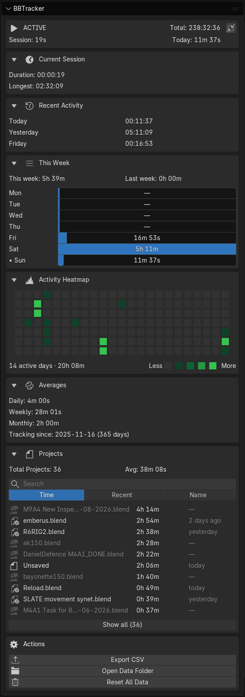

# BBTracker - Blender Statistics Tracker
(BBTracker) Blender Statistics Tracker - Automatic productivity tracking for Blender with AFK detection, project analytics, and session monitoring.

# Blender Time Tracker

A comprehensive time tracking addon for Blender that helps you monitor your productivity and project time.

## Features

- **Automatic Time Tracking** - Tracks time spent in Blender automatically
- **AFK Detection** - Pauses tracking after 10 minutes of inactivity
- **Project-based Tracking** - Tracks time per .blend file
- **Weekly Analytics** - Visual breakdown of your weekly productivity
- **Compact & Detailed Views** - Toggle between minimal and detailed UI
- **Collapsible Sections** - Organize the UI to your preference
- **Session History** - Track current and longest sessions
- **Status Bar Counter** - Today's and total time always visible at the bottom of Blender
- **Activity Heatmap** - GitHub-style grid of your daily activity (hover a day for details)
- **Projects List** - Search, sort by time / recent / name, click a project to open it
- **CSV Export** - Daily, per-project and per-session data for Excel / Google Sheets
- **Preferences** - AFK timeout, render counting, background counting, status bar options

## Installation

1. Download the latest release from [Releases](https://github.com/Budloks/BBTracker/releases)
2. In Blender (4.2 or newer, tested on 5.3): Edit → Preferences → Get Extensions → ⌄ menu (top right) → Install from Disk...
3. Select the downloaded `bbtracker-x.y.z.zip` file (or drag & drop the zip into Blender)
4. Make sure "BBTracker" is enabled under Add-ons

To build the zip yourself: `blender --command extension build` in this folder.

## Usage

The addon automatically starts tracking when enabled. Find the panel in:
Properties Editor → Scene → Time Tracker

### Key Features:
- **Status Indicator**: Shows ACTIVE/AFK status
- **Quick Stats**: Always-visible overview of current session and totals
- **Weekly Distribution**: Visual breakdown of your week with percentages
- **Project Tracking**: Time spent per .blend file
- **Averages**: Daily, weekly, and monthly averages

## Data Storage

Your time tracking data is stored locally, shared by every Blender version, at:
`%APPDATA%\Blender Foundation\Blender\BBTracker\bbtracker_data.json` (Windows)
`~/.config/blender/BBTracker/bbtracker_data.json` (Linux)
`~/Library/Application Support/Blender/BBTracker/bbtracker_data.json` (macOS)

Updating Blender does not reset your hours. On first start, data from older
versions (`<version>/config/blender_time_tracker.json`) is imported automatically.
Every save is atomic, the previous copy is kept as `.bak`, and daily backups are
kept in the `backups` folder (also made before "Reset All Data").
Use "Open Data Folder" in the panel to find it.

## Support

If you encounter any issues:
1. Check the [Issues](https://github.com/Budloks/BBTracker/issues) page
2. Create a new issue with:
   - Blender version
   - Steps to reproduce
   - Error message (if any)

## License

Creative Commons Attribution-NonCommercial-NoDerivatives 4.0 International - see [LICENSE](LICENSE) file for details.
